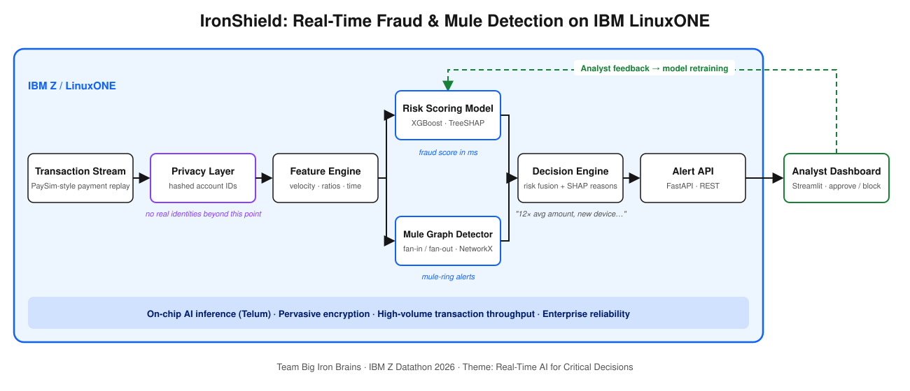

# 🛡️ IronShield

**Real-time, explainable fraud and mule-account detection on IBM Z / LinuxONE**

Team **Big Iron Brains** · IBM Z Datathon 2026 · Event code **SSF2026** · Theme: *Real-Time AI for Critical Decisions* (with *AI Secured: Innovation Without Exposure*)

**Team:** Syed Mohammad Huzaifa (lead) · Munawwer Khan · Shaikh Muhammad Zain · Abdul Akhir Saifullah

---

## The problem

Scammers trick people into instant transfers, then launder the money through **mule accounts** that collect from several victims and forward everything within minutes. Batch fraud checks run after the money has moved, and analysts get alerts with no explanation.

## What IronShield does

| | |
|---|---|
| ⚡ **Real-time scoring** | Every payment gets a fraud-risk score in about a millisecond, before the money moves |
| 🕸️ **Mule-network detection** | A live transaction graph flags accounts with many senders that forward money within minutes, and draws the whole ring |
| 💬 **Explainable alerts** | Each alert lists plain-English reasons (exact TreeSHAP contributions turned into text), e.g. *"moves 95% of the account balance · made from a new device · receiver got money from 3 different senders in the last hour"* |
| 🔒 **Privacy-first** | Account IDs are replaced with keyed HMAC-SHA256 pseudonyms before any analysis; the AI never sees real identities |
| 👩‍💼 **Human in the loop** | Analysts block or approve alerts on a live dashboard; decisions are stored as labels and used in the next retraining |



## Why IBM Z / LinuxONE

Fraud decisions only matter if they happen **before the money moves**, and banks already process those payments on IBM Z. Running the decision engine on LinuxONE means scoring in-line, next to the system of record, with no copying of sensitive data to outside systems, on a platform built for transaction throughput, pervasive encryption and on-chip AI inference (Telum). The model is saved in XGBoost's portable JSON format and can be compiled for Telum's AI accelerator with the IBM Z Deep Learning Compiler (ONNX) as the production path.

## Results (measured on IBM LinuxONE, s390x)

Held-out "future" transactions (time-ordered split: 27,066 transactions, 342 frauds), model trained on LinuxONE:

| Metric | Value |
|---|---|
| Precision (alerts that were real fraud) | **96.3%** |
| Recall (share of fraud caught) | **92.1%** |
| PR-AUC | 0.990 |
| Mule rings caught | **19 / 19** |
| End-to-end decision time (privacy + features + model + mule graph + explanation), median | **0.087 ms** |
| p95 / p99 | 0.43 ms / 1.15 ms |
| Throughput, single core | **~7,750 transactions/s** |

Raw numbers: [`results/benchmark_s390x.json`](results/benchmark_s390x.json), [`results/model_metrics.json`](results/model_metrics.json).
Live API on LinuxONE Community Cloud: `http://148.100.109.96:8000/docs` (available during judging).

> The data is synthetic (see below), so these numbers show the system works end to end; real-bank performance would need real data.

## Data

- **Synthetic payment stream** (`ironshield/datagen.py`) in the public **PaySim** schema: ~90,000 transactions over 5 days from 6,000 customers, with 90 planted scam campaigns (victims → mule rings → collector → cash-out, 40% at night, 40% account takeovers on new devices) plus legitimate hard cases (popular payees with many senders, legitimately large transfers).
- **PaySim** (Kaggle) can be used directly: `python -m scripts.train --paysim PS_20174392719_1491204439457_log.csv`.
- No real personal data is used.

## Run it

### On IBM LinuxONE (API + model)
```bash
git clone <this repo> && cd ironshield
bash deploy/setup_linuxone.sh          # installs prebuilt s390x packages, trains, benchmarks, runs the API as a systemd service on :8000
# if a package will not install natively on s390x:
bash deploy/setup_linuxone.sh docker   # uses IBM's prebuilt s390x ML image (pandas, scikit-learn, XGBoost)
```

### Dashboard (analyst laptop)
```bash
pip install -r requirements-dashboard.txt
IRONSHIELD_API=http://<linuxone-ip>:8000 streamlit run dashboard/app.py
```
Click **🚨 Launch a live scam campaign** to watch IronShield catch a scam as it happens.

### Everything locally
```bash
python -m venv .venv && .venv/Scripts/activate      # or source .venv/bin/activate
pip install -r requirements.txt -r requirements-dashboard.txt pytest
python -m scripts.train          # generates data, trains, writes results/model_metrics.json
python -m scripts.benchmark      # writes results/benchmark_<machine>.json
uvicorn ironshield.api:app --port 8000
streamlit run dashboard/app.py
pytest -q
```

## API

| Endpoint | Purpose |
|---|---|
| `POST /score` | Score one transaction (raw IDs are pseudonymised on arrival) |
| `GET /alerts`, `GET /feed`, `GET /stats` | Alerts, live feed, latency / precision / platform stats |
| `GET /alerts/{id}/network` | The suspicious money trail around an alert |
| `POST /feedback` | Analyst decision (`block` / `approve`), stored for retraining |
| `POST /stream/{start,stop,speed}` | Control the simulated payment stream |
| `POST /demo/inject-scam` | Inject a live scam campaign for demos |

Interactive docs at `/docs`.

## Project layout

```
ironshield/   privacy.py  features.py  model.py  explain.py  mule.py  engine.py  stream.py  api.py  datagen.py
dashboard/    app.py (Streamlit)
scripts/      train.py  benchmark.py
deploy/       setup_linuxone.sh
tests/        test_ironshield.py
```
